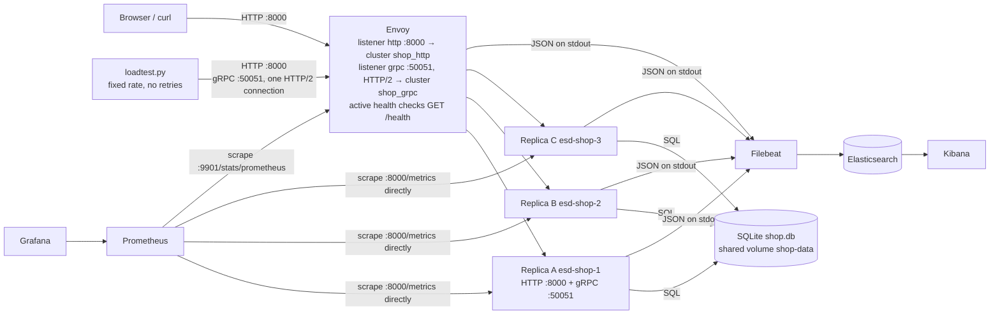
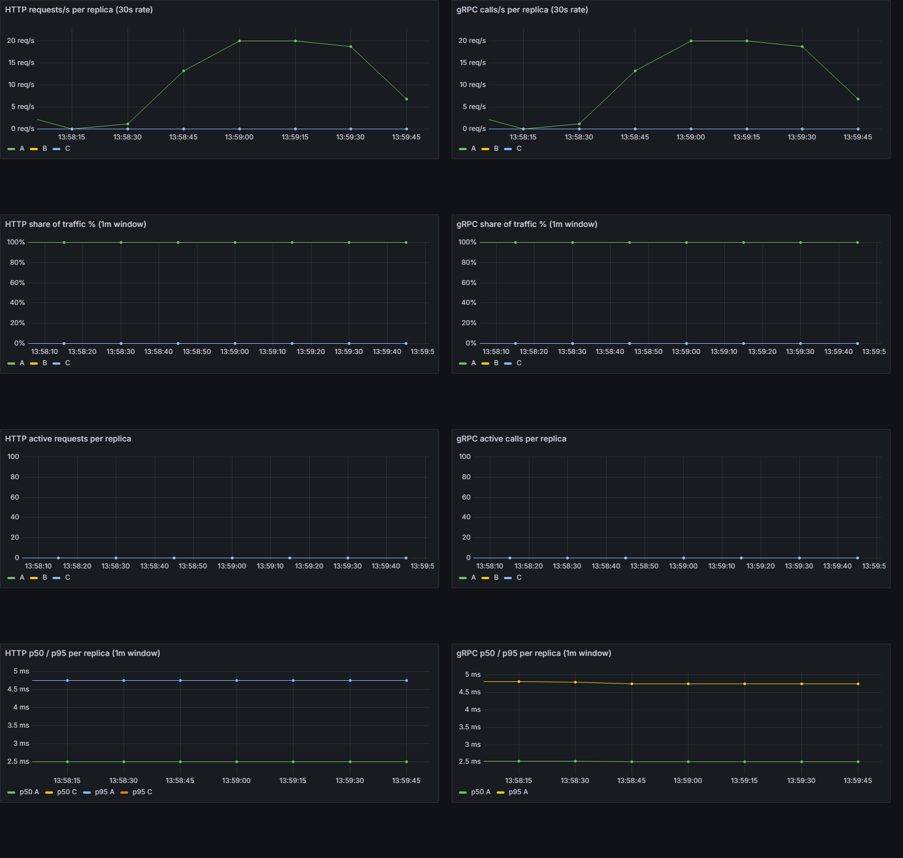
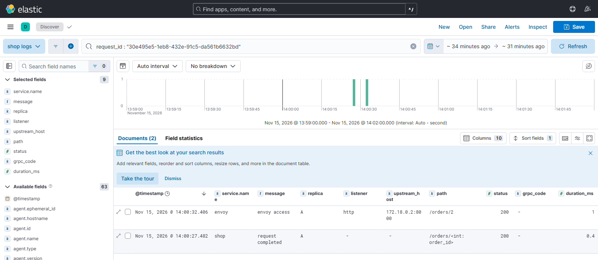
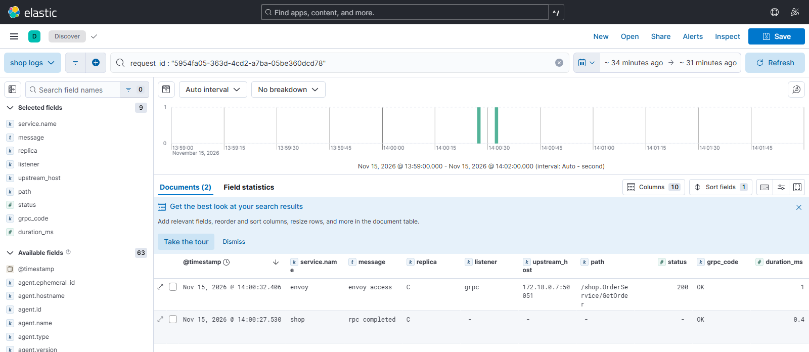
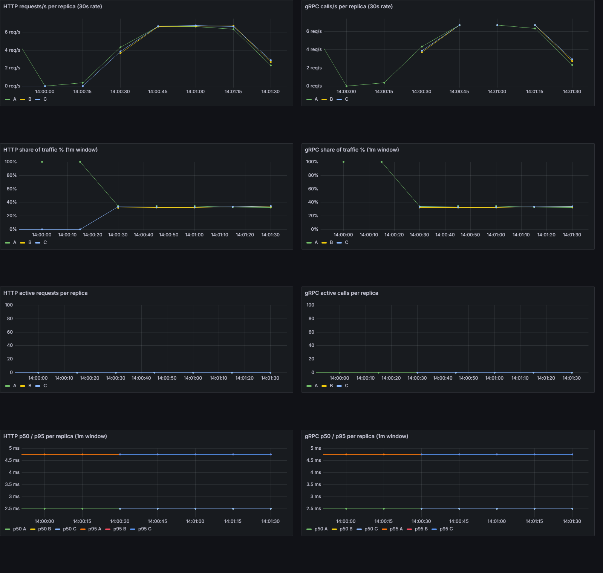
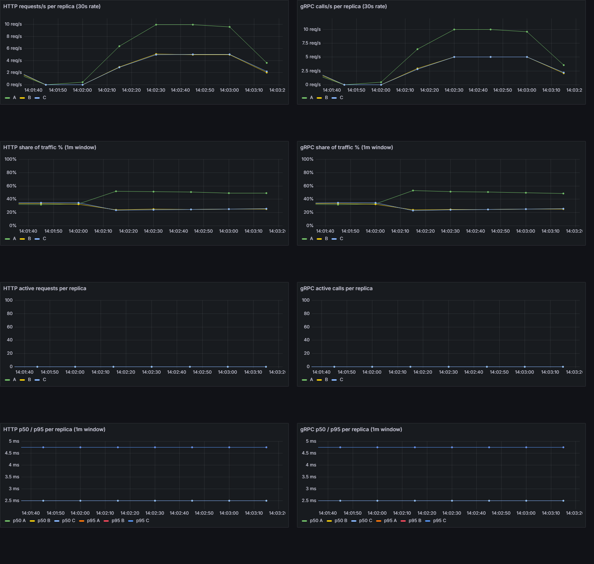
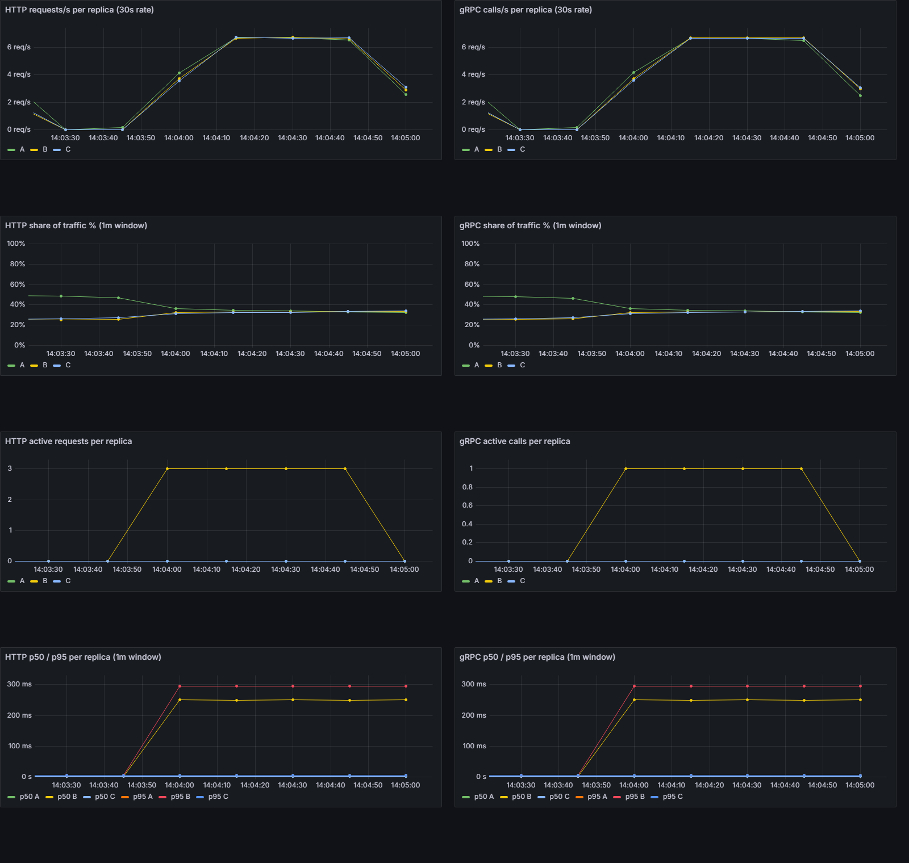
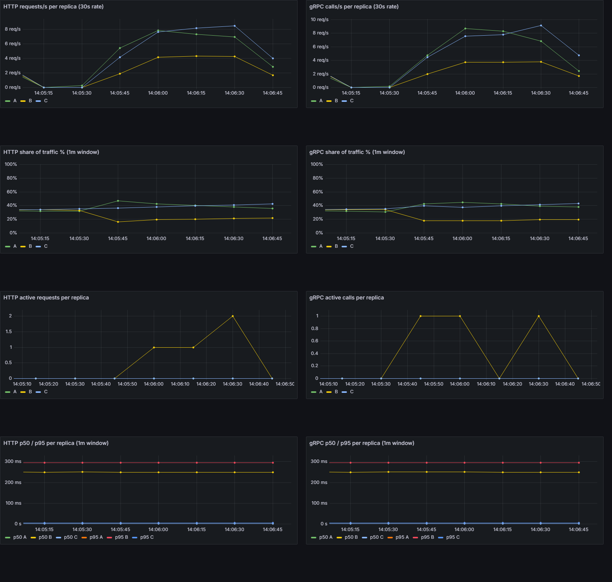
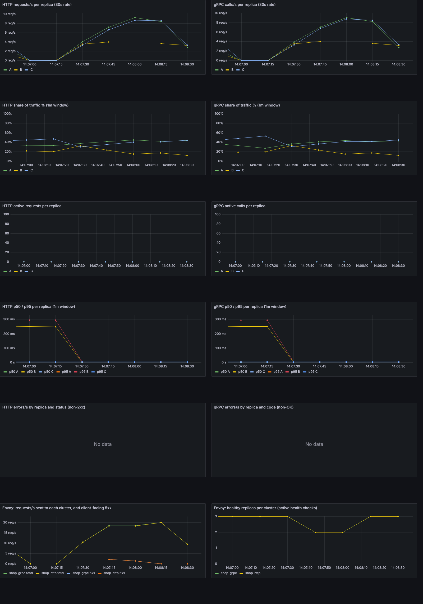

# Assignment 3 – Load balancing and observability: Mini Shop

Extends A2. Three replicas of the shop run behind Envoy. All numbers and charts below are from one
session on 15 Nov 2026 (UTC times; the Grafana screenshots show local time, UTC+5).

## A. Replicas and routing

### Architecture



- **Replicas:** one Compose service `shop` with `deploy.replicas: 3`. Compose names the
  containers `esd-shop-1/2/3` (project name fixed with `name: esd`). Each container runs Flask
  (HTTP) and the gRPC server in one process (`app/main.py` starts `grpc_server.serve()`), so every
  replica exposes the same HTTP endpoints and gRPC methods. The replicas publish no ports; all
  client traffic enters through Envoy.
- **Replica identifier:** `app/logs.py` `find_replica()` checks which of `esd-shop-1/2/3`
  resolves to the container's own IP, giving `A`, `B` or `C`. It appears in every log line
  (`"replica": "B"`), in the HTTP response header `X-Replica`, and in gRPC response metadata
  `x-replica`. In metrics, Prometheus adds the label `replica="A|B|C"` to each scrape target
  (`monitoring/prometheus.yml`). The set of values is small and fixed, so cardinality stays
  bounded.
- **Correlation:** Envoy creates or forwards `x-request-id` for both HTTP and gRPC. The replica
  reads it (the `X-Request-ID` header or `x-request-id` metadata) and logs it as `request_id`, and
  Envoy logs the same value.
- **Envoy config:** `envoy/envoy.json` is generated by `scripts/envoy_config.py <setup>`. In Part A
  it uses `a-only`: both clusters list only `esd-shop-1`, while B and C keep running.
- **Test traffic:** read-only. HTTP `GET /orders/{id}` and gRPC `OrderService.GetOrder` (added to
  `proto/orders.proto`) both call the same `shop.get_order()`.

### Shared or per replica?

| State | Where | Shared? | What happens when traffic is spread |
|---|---|---|---|
| Orders (data) | SQLite file on the `shop-data` volume, mounted by all replicas | **Shared** | An order written via A can be read via B or C. Works because all replicas run on one Docker host; across machines this would need a real database server. |
| Idempotency records | `UNIQUE idempotency_key` column in the same table | **Shared** | A retry with the same key that lands on another replica still hits the UNIQUE constraint, so it returns the first order with no second charge. |
| Rate-limit counters | `rate_hits` dict in each process (`main.py`) | **Per replica** | Each replica allows 30 orders per 10 s on its own. With round robin a client really gets about 90 per 10 s, a 429 depends on which replica answers, and `Retry-After` from one replica means nothing to the others. Fix: keep the counters in a shared store (e.g. Redis), or rate-limit once in Envoy. |
| Fault settings, Prometheus counters | Memory | Per replica | Intended: a delay is injected on B only, and each replica reports its own metrics. |

One bug appeared as soon as Envoy sat in front: every request now came from Envoy's IP, so all
clients shared one rate-limit bucket. `rate_limit_wait()` now uses the first address in
`X-Forwarded-For`.

## B. Baseline (A only)

**Dashboard:** "Load balancing (A3)" (`monitoring/grafana/dashboards/load-balancing.json`, uid
`lb`). HTTP and gRPC panels sit side by side, per replica:

| Panel | Query (HTTP; gRPC uses `grpc_server_handled_total`, `grpc_server_in_flight`, `grpc_server_handling_seconds`) |
|---|---|
| Rate per replica | `sum by (replica) (rate(http_requests_total{job="shop"}[30s]))` |
| Share of traffic % | `100 * sum by (replica) (rate(http_requests_total{job="shop"}[1m])) / scalar(sum(rate(http_requests_total{job="shop"}[1m])))` |
| Active requests | `sum by (replica) (http_requests_in_flight)` |
| p50 / p95, **1-minute window** | `histogram_quantile(0.95, sum by (le, replica) (rate(http_request_duration_seconds_bucket{job="shop"}[1m])))` |
| Errors by status | `sum by (replica, status) (rate(http_requests_total{job="shop", status!~"2.."}[1m]))` (gRPC: `code!="OK"`) |
| Envoy | `rate(envoy_cluster_upstream_rq_total[30s])`, `envoy_cluster_upstream_rq_xx{envoy_response_code_class="5"}`, `envoy_cluster_membership_healthy` |

Prometheus scrapes `esd-shop-1:8000`, `esd-shop-2:8000`, `esd-shop-3:8000` and `envoy:9901`
directly, every 5 s. `/health` (Envoy's health checks) and `/metrics` are excluded from request
metrics and logs, so idle replicas really show 0. Histogram buckets now start at 5 ms, because
reads take under 1 ms on the server.

**Workload:** `python scripts/loadtest.py --rate 20 --seconds 60` sends 20 requests/s **per
interface** (HTTP and gRPC at the same time) for 60 s, on a timer. It never waits for an answer
before sending the next: HTTP uses a thread pool, gRPC uses `.future()` calls over **one**
channel. Timeout is 5 s, with no retries and no circuit breaker. It records sent, success, failed,
client p50/p95, and which replica answered.

**Result (run 1, 08:58:25–08:59:31):**

| Interface | Sent | OK | Failed | Rate | Client p95 | Shares A/B/C |
|---|---|---|---|---|---|---|
| HTTP | 1200 | 1200 | 0 | 20.0/s | 30.4 ms | 100 / 0 / 0 |
| gRPC | 1200 | 1200 | 0 | 20.0/s | 8.2 ms | 100 / 0 / 0 |

As expected, A handles everything; B and C are running (scraped, health-checked) but idle.
Client HTTP latency (~12 ms p50) is far above server time (<1 ms) because Python `requests` opens
a new connection per call. gRPC reuses one connection, so it is faster.



**Envoy + replica logs.** Envoy writes a JSON access log (`replica` from the `X-Replica` response
header, `upstream_host`, `request_id`, `status`, `grpc_code`, `duration_ms`, `response_flags`) to
stdout. The container is labelled `logs=json`, so Filebeat ships it exactly like the app logs.
Searching one ID returns both sides:

```text
KQL: request_id : "30e495e5-1eb8-432e-91c5-da561b6632bd"        (HTTP)
envoy  envoy access       replica=A listener=http upstream_host=172.18.0.2:8000  path=/orders/2 status=200 duration_ms=1
shop   request completed  replica=A path=/orders/<int:order_id> status=200 duration_ms=0.4

KQL: request_id : "5954fa05-363d-4cd2-a7ba-05be360dcd78"        (gRPC)
envoy  envoy access       replica=C listener=grpc upstream_host=172.18.0.7:50051 path=/shop.OrderService/GetOrder status=200 grpc_code=OK
shop   rpc completed      replica=C method=GetOrder grpc_code=OK duration_ms=0.4
```




(These two IDs come from the round-robin run, so the gRPC call landed on C.)

## C. Round robin

`python scripts/envoy_config.py round-robin && docker compose restart envoy`: both clusters list A,
B and C with weight 1, `lb_policy: ROUND_ROBIN`. The gRPC listener uses `codec_type: HTTP2` and
the gRPC cluster speaks HTTP/2 upstream, so Envoy sees every call and routes **per call**, even
though the client keeps a single connection.

| Interface | Shares A / B / C | vs 33.3 % | Client p95 |
|---|---|---|---|
| HTTP | 33.2 / 33.4 / 33.3 | ±0.1 pt | 30.3 ms |
| gRPC | 33.3 / 33.3 / 33.3 | 0 | 6.5 ms |

Compared with the A-only baseline, the traffic is simply split three ways. Round robin is
deterministic and every request costs the same, so the shares are almost exact. Latency does not
change: 20 req/s was nowhere near A's capacity, so spreading the load gives no speed-up here, only
spare capacity.

**Checked against Envoy's access logs** (same time range, test paths only): HTTP A 399 / B 401 /
C 400, gRPC 400 / 400 / 400 out of 1200 each. This matches the client's count exactly.



## D. Experiments

Every experiment starts from round robin with no delay, uses the same workload, and is restored
afterwards. The client has no retries and no circuit breaker.

### 1. Weighted round robin (2 : 1 : 1)

- **Prediction:** shares of 50/25/25. Latency and active requests barely change, because no
  replica is busy.
- **Observed:** HTTP 49.9 / 25.1 / 25.0, gRPC 50.0 / 25.0 / 25.0. Client p95: HTTP 33.2 ms, gRPC
  4.5 ms. Active requests stay at 0–1 everywhere.
- **Explanation:** Envoy's weighted round robin hits the target exactly. A does twice the work, but
  each read takes under 1 ms, so A never queues and latency does not move. **A higher weight adds
  no capacity**: it only sends A more work. If A were near its limit, its active requests and p95
  would rise first.



### 2. Least request vs round robin, with B slowed by 200 ms

`python scripts/delay.py B 200` makes every HTTP request and gRPC call on B wait 200 ms.

- **Prediction:** round robin ignores speed, so B keeps 33 % and about a third of requests become
  slow. Least request (Envoy's "power of two choices": pick 2 replicas at random, use the one with
  fewer active requests) should send B fewer calls, because B's calls stay open longer.

| Run | Interface | Shares A / B / C | Client p50 | Client p95 |
|---|---|---|---|---|
| Round robin + B 200 ms | HTTP | 33.2 / 33.4 / 33.3 | 26.2 ms | 228.4 ms |
| Round robin + B 200 ms | gRPC | 33.3 / 33.3 / 33.3 | 7.2 ms | 207.6 ms |
| Least request + B 200 ms | HTTP | 38.7 / **20.4** / 40.9 | 15.5 ms | 225.6 ms |
| Least request + B 200 ms | gRPC | 39.4 / **18.8** / 41.8 | 6.7 ms | 207.8 ms |

- **Observed:** with least request, B's share dropped from 33 % to about 19–20 % and A and C
  picked up the rest. On the dashboard, B is the only replica with active requests (1–2; A and C
  sit at 0). B's p50 and p95 on the server side stay around 250–300 ms. That is histogram
  interpolation inside the 0.2–0.3 s bucket; the true value is 200 ms. HTTP client p50 improved
  (26 → 15.5 ms) because fewer requests hit B.
- **Explanation:** least request only avoids B when B already has a call open, and at 20 req/s
  per interface B is idle about half the time. So B still gets about 20 %, not 0 %. Client **p95
  did not improve**: as long as B gets more than 5 % of calls, the 95th percentile lands on a
  slow B call. B also stays healthy the whole time, because `/health` answers instantly. **A slow
  replica passes health checks**; only the balancing policy reacts to slowness.




### 3. Failure and recovery (round robin, no delay)

**Active health checks** (both clusters, `scripts/envoy_config.py`): `GET /health` on port 8000
over HTTP/1.1, **interval 2 s, timeout 1 s, unhealthy threshold 2, healthy threshold 2**. Envoy's
DNS refresh for `STRICT_DNS` hosts is 5 s, and `ignore_health_on_host_removal: true` (see the note
below).

- **Prediction:** after B stops, connections to it are refused until 2 health checks fail, about
  2–5 s. During that window B's third of requests fails (about 7 per second per interface). Once B
  is restarted it gets traffic again after its health checks pass.

| Time (UTC) | Event |
|---|---|
| 09:07:32.06 | `docker stop esd-shop-2` |
| 09:07:33.4 | first failed request (Envoy flag `UF`, upstream connection failure) |
| 09:07:39.6 | B removed from both clusters; last failure at 09:07:39.x |
| 09:07:53.77 | `docker start esd-shop-2` |
| 09:07:55.50 | B back in the clusters, marked `/failed_active_hc` (not used yet) |
| 09:07:59.66 | B healthy, receives traffic again |

| Interface | Sent | Failed | Error rate | Client p95 | Shares A / B / C |
|---|---|---|---|---|---|
| HTTP | 1200 | 40 | 3.3 % | 32.3 ms | 40.5 / 20.1 / 39.4 |
| gRPC | 1200 | 39 | 3.3 % | 125.7 ms | 40.0 / 20.1 / 40.0 |

- **Observed:**
  - **Errors:** about 6.3 s of errors at about 6.7/s per interface, which matches B's third. B's
    share of 20 % fits it being out for 26 of 60 s.
  - **Recovery:** B took 5.9 s to come back; no errors happened during recovery, because Envoy
    only sends to B after a passing health check.
  - **Where the errors show up:** the per-replica error panels stay empty. The failed requests
    never reached a replica, so only Envoy (5xx panel) and the client see them.
  - **gRPC failures in Envoy's metrics:** they are HTTP status 200 with `grpc-status: UNAVAILABLE`,
    so they do **not** appear in Envoy's 5xx counter. Envoy's access log has them (`grpc_code`
    `UNAVAILABLE`).
- **Explanation of timing:**
  - **Removal took ~6.3 s** after B stopped answering. With a 2 s interval and 2 failures needed,
    the health-check settings alone allow 2–5 s, and Envoy's DNS refresh is every 5 s, so the
    removal falls within about one interval of those settings.
  - **Recovery took 5.9 s:** app start (~1.5 s), then Envoy picking B up again and B passing its
    health check before receiving traffic.

*Note on `ignore_health_on_host_removal`.* Without it, after the replicas were recreated Envoy kept
A's **old IP** because it still passed health checks. That IP now belonged to C, so "A only" sent
traffic to C. With the option, a host that disappears from DNS is dropped at once.



### Summary of all runs (target 20 req/s per interface, 60 s)

| Run / interface | Policy and fault | Target / actual rps | A / B / C share % | Client p95 | Error rate | Explanation |
|---|---|---|---|---|---|---|
| 1 HTTP | A only | 20 / 20.0 | 100 / 0 / 0 | 30.4 ms | 0 % | baseline, B and C idle |
| 1 gRPC | A only | 20 / 20.0 | 100 / 0 / 0 | 8.2 ms | 0 % | baseline |
| 2 HTTP | round robin | 20 / 20.0 | 33.2 / 33.4 / 33.3 | 30.3 ms | 0 % | even split, no latency change (not loaded) |
| 2 gRPC | round robin (HTTP/2) | 20 / 20.0 | 33.3 / 33.3 / 33.3 | 6.5 ms | 0 % | per-call balancing over one connection |
| 3 HTTP | weighted 2:1:1 | 20 / 20.0 | 49.9 / 25.1 / 25.0 | 33.2 ms | 0 % | matches 50/25/25 |
| 3 gRPC | weighted 2:1:1 | 20 / 20.0 | 50.0 / 25.0 / 25.0 | 4.5 ms | 0 % | matches 50/25/25 |
| 4 HTTP | round robin, B +200 ms | 20 / 20.0 | 33.2 / 33.4 / 33.3 | 228.4 ms | 0 % | RR ignores slowness |
| 4 gRPC | round robin, B +200 ms | 20 / 20.0 | 33.3 / 33.3 / 33.3 | 207.6 ms | 0 % | same |
| 5 HTTP | least request, B +200 ms | 20 / 20.0 | 38.7 / 20.4 / 40.9 | 225.6 ms | 0 % | B share down, p50 better, p95 still B |
| 5 gRPC | least request, B +200 ms | 20 / 20.0 | 39.4 / 18.8 / 41.8 | 207.8 ms | 0 % | same |
| 6 HTTP | round robin, B stopped 20 s | 20 / 20.0 | 40.5 / 20.1 / 39.4 | 32.3 ms | 3.3 % | ~6 s of 503 until B removed |
| 6 gRPC | round robin, B stopped 20 s | 20 / 20.0 | 40.0 / 20.1 / 40.0 | 125.7 ms | 3.3 % | UNAVAILABLE until B removed |

Raw results: `results/runs.jsonl` (one JSON line per run with start/end time).

## Conclusions

1. **Choice.** For **HTTP**, least request: with healthy replicas it splits like round robin, and
   when one replica was slow it moved traffic away (B 33 % → 20 %, client p50 26 → 15.5 ms) at no
   cost. For **gRPC**, also least request, on an **HTTP/2 listener**, because per-call balancing is
   what makes any policy work for one long-lived gRPC connection. In our run it reduced the slow
   replica's share the same way (33 % → 19 %). Neither policy fixes p95 on its own while a slow
   replica stays healthy, so a real setup would add outlier detection or a latency-based health
   signal.
2. **When I'd choose differently:** for requests that benefit from cache affinity, for example
   per-product data cached in memory, I'd use **consistent hashing** on the product ID, so the same
   product always goes to the same replica. For replicas of different sizes (one big machine, two
   small ones), I'd use **weighted round robin**.
3. **If Envoy stops,** every client fails, for both HTTP and gRPC, even though A, B and C are
   healthy. Envoy is a single point of failure. Prometheus would show the `envoy` target down and
   all three replicas at zero traffic. **Improvement:** run two Envoy instances behind a floating
   IP or DNS name (e.g. keepalived), or let gRPC clients fall back to client-side round robin over
   the replica addresses.

